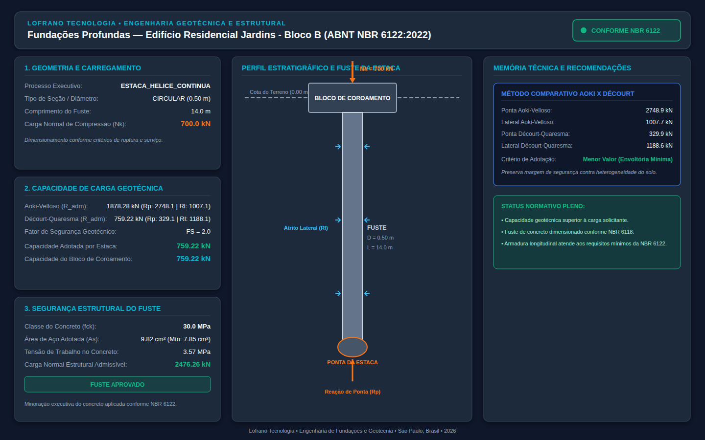
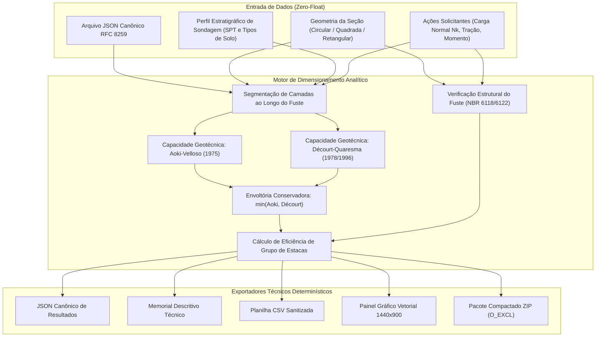

# Dimensionamento de Fundações Profundas (ABNT NBR 6122:2022)

[](https://github.com/martinlofranodeoliveira/dimensionamento-fundacoes-profundas-nbr6122/actions/workflows/ci.yml)
[](https://www.python.org/)
[](LICENSE)
[-emerald.svg)](https://docs.python.org/3/library/fractions.html)
[](https://www.abnt.org.br/)

Motor computacional determinístico e analítico para dimensionamento geotécnico e verificação estrutural de fundações profundas (estacas e tubulões) conforme a norma **ABNT NBR 6122:2022** (*Projeto e Execução de Fundações*) e a **ABNT NBR 6118:2023** (*Projeto de Estruturas de Concreto*).

Desenvolvido no padrão de engenharia **LOFRANO TECNOLOGIA**, com **Zero Dependências externas** (exclusivamente biblioteca padrão do Python), **Zero-Float** (aritmética 100% exata com números inteiros e frações racionais `fractions.Fraction`) e conformidade estrita com RFC 8259.

---

## Painel Esquemático de Engenharia

O módulo gera automaticamente diagramas vetoriais SVG em resolução 1440x900 apresentando o corte esquemático do perfil estratigráfico, embutimento da estaca no solo resistente, bloco de coroamento e quadro comparativo completo entre métodos:



---

## Fundamentação Teórica e Normativa

### 1. Métodos Semiempíricos de Capacidade de Carga Geotécnica

A norma **ABNT NBR 6122:2022** prescreve que a capacidade de carga última de uma estaca ($R_{ult}$) é composta pela soma da resistência de ponta ($R_p$) e da resistência por atrito lateral ao longo do fuste ($R_l$):

$$R_{ult} = R_p + R_l$$

A carga admissível de projeto ($R_{adm}$) é obtida pela aplicação de um fator de segurança geotécnico global ($F_S = 2{,}0$ para cálculo sem prova de carga, ou $F_S = 1{,}6$ com realização de prova de carga estática conforme NBR 6122 item 8.2.2):

$$R_{adm} = \frac{R_{ult}}{F_S}$$

#### Método de Aoki-Velloso (1975)
No método de Aoki-Velloso, a capacidade última é calculada a partir de coeficientes geotécnicos $K$ (capacidade de carga de base) e $\alpha$ (relação de atrito lateral), minorados pelos fatores executivos $F_1$ e $F_2$ característicos de cada processo de cravação ou perfuração:

$$R_p = \frac{K \cdot N_p \cdot A_p}{F_1}$$

$$R_l = \frac{U}{F_2} \sum_{i=1}^{m} \left( \alpha_i \cdot K_i \cdot N_{s,i} \cdot \Delta L_i \right)$$

Onde:
- $N_p$: índice de resistência à penetração SPT na cota de apoio da ponta (limitado normativamente a 50).
- $N_{s,i}$: índice SPT médio da $i$-ésima camada atravessada pelo fuste.
- $A_p$: área da seção transversal da ponta ($m^2$).
- $U$: perímetro do fuste da estaca ($m$).
- $\Delta L_i$: espessura do trecho da estaca em contato com a $i$-ésima camada ($m$).
- $F_1, F_2$: coeficientes de minoração do tipo de estaca (ex.: Hélice contínua $F_1=2{,}0; F_2=4{,}0$; Pré-moldada $F_1=1{,}75; F_2=3{,}50$; Escavada $F_1=3{,}0; F_2=6{,}0$).

#### Método de Décourt-Quaresma (1978 / 1996)
O método de Décourt-Quaresma correlaciona a resistência de ponta ao coeficiente característico do solo $C$ e a resistência lateral à expressão semiempírica do atrito unitário $q_l$, parametrizados pelos fatores $\alpha_{DQ}$ e $\beta_{DQ}$:

$$R_p = \alpha_{DQ} \cdot C \cdot N_p \cdot A_p$$

$$R_l = U \sum_{i=1}^{m} \left( \beta_{DQ} \cdot q_{l,i} \cdot \Delta L_i \right)$$

Com atrito lateral unitário de base dado por:

$$q_{l,i} = 10 \cdot \left( \frac{N_{s,i}}{3} + 1 \right) \quad [\text{em kPa}]$$

*Nota normativa*: $q_{l,i}$ é limitado ao valor máximo conservador de $120\text{ kPa}$.

#### Critério de Adotação de Capacidade Admissível
Por critério conservador de segurança da engenharia de fundações, o sistema adota a menor capacidade admissível entre os métodos:

$$R_{adm,adotada} = \min \left( R_{adm,Aoki}, R_{adm,D\acute{e}court} \right)$$

---

### 2. Verificação Estrutural do Fuste (NBR 6118 / NBR 6122)

O fuste da estaca deve suportar a força normal característica atuante ($N_k$), respeitando a capacidade resistente de projeto com coeficientes de ponderação do concreto ($\gamma_c = 1{,}4$), do aço ($\gamma_s = 1{,}15$) e o fator de minoração executiva $\phi_{exec}$ (NBR 6122 item 8.2):

$$N_{adm,est} = \frac{0{,}85 \cdot f_{cd} \cdot A_c \cdot \phi_{exec} + f_{yd} \cdot A_s}{1{,}4}$$

Onde:
- $f_{cd} = f_{ck} / 1{,}4$: resistência de cálculo à compressão do concreto.
- $\phi_{exec}$: fator de minoração de concretagem (0,85 para estacas escavadas e hélice contínua; 0,90 para estacas raiz; 1,00 para pré-moldadas e cravadas).
- $A_s \ge 0{,}4\% \cdot A_c$: taxa mínima de armadura longitudinal obrigatória.

---

### 3. Efeito de Grupo de Estacas

Quando a fundação é composta por um bloco com $n$ estacas, avalia-se o espaçamento entre eixos ($s$) em relação ao diâmetro ($D$):
- $s \ge 3{,}0 \cdot D$: Eficiência plena do bloco ($\eta = 1{,}00$).
- $2{,}5 \cdot D \le s < 3{,}0 \cdot D$: Eficiência conservadora ($\eta = 0{,}90$).
- $2{,}0 \cdot D \le s < 2{,}5 \cdot D$: Eficiência reduzida ($\eta = 0{,}80$).
- $s < 2{,}0 \cdot D$: Bloco crítico ($\eta = 0{,}70$) com alerta de espaçamento insuficiente.

$$R_{bloco} = n \cdot R_{adm,adotada} \cdot \eta$$

---

## Arquitetura do Sistema



---

## Instalação e Requisitos

- **Python 3.11 ou superior** (compatível com 3.11, 3.12, 3.13 e 3.14).
- **Zero dependências externas**: sem necessidade de `pip install` de pacotes de terceiros.

```bash
git clone https://github.com/martinlofranodeoliveira/dimensionamento-fundacoes-profundas-nbr6122.git
cd dimensionamento-fundacoes-profundas-nbr6122
python3 -m unittest discover -s tests -v
```

---

## Interface de Linha de Comando (CLI)

O executável de linha de comando `fundacoes-profundas-nbr6122` disponibiliza subcomandos para consulta de parâmetros normativos, geração de modelos de entrada e cálculo completo com exportação de múltiplos artefatos:

```bash
# 1. Consulta ao catálogo de coeficientes geotécnicos e fatores de estacas
fundacoes-profundas-nbr6122 catalogo

# 2. Geração de modelo JSON de entrada
fundacoes-profundas-nbr6122 gerar-exemplo -t estaca-helice -o projeto_edificio.json

# 3. Execução do dimensionamento com geração completa de artefatos
fundacoes-profundas-nbr6122 calcular projeto_edificio.json \
    -o resultado.json \
    --memorial memorial_calculo.txt \
    --csv resumo_tecnico.csv \
    --svg painel_obra.svg \
    --pacote-zip entrega_completa.zip
```

---

## Uso Programático via API Python

```python
from fractions import Fraction
from fundacoes_profundas_nbr6122.models import (
    DadosProjetoFundacaoProfunda,
    GeometriaEstaca,
    TipoSecaoTransversal,
    TipoProcessoExecutivo,
    CamadaSoloSPT,
    SolicitacaoCarga,
    EfeitoGrupoEstacas,
)
from fundacoes_profundas_nbr6122.calculator import dimensionar_projeto_fundacao_profunda
from fundacoes_profundas_nbr6122.exporters import gerar_memorial_fundacao_texto

# Definição do projeto em frações exatas (Zero-Float)
projeto = DadosProjetoFundacaoProfunda(
    identificacao_projeto="Edifício Residencial Jardins - Bloco B",
    processo_executivo=TipoProcessoExecutivo.ESTACA_HELICE_CONTINUA,
    geometria=GeometriaEstaca(
        tipo_secao=TipoSecaoTransversal.CIRCULAR,
        diametro_ou_lado_m=Fraction(1, 2),       # Diâmetro D = 0.50 m
        comprimento_fuste_m=Fraction(14, 1),      # Fuste L = 14.0 m
        fck_concreto_mpa=Fraction(30, 1),         # Concreto C30
    ),
    perfil_solo=(
        CamadaSoloSPT(Fraction(0, 1), Fraction(3, 1), "ARGILA_SILTOSA", 4),
        CamadaSoloSPT(Fraction(3, 1), Fraction(8, 1), "SILTE_ARENOSO", 9),
        CamadaSoloSPT(Fraction(8, 1), Fraction(12, 1), "AREIA_SILTOSA", 18),
        CamadaSoloSPT(Fraction(12, 1), Fraction(18, 1), "AREIA", 28),
    ),
    solicitacao=SolicitacaoCarga(forca_normal_compressao_kn=Fraction(750, 1)),
    grupo=EfeitoGrupoEstacas(numero_estacas_bloco=1, espacamento_entre_eixos_m=Fraction(0, 1)),
    possui_prova_carga=False,
    responsavel_tecnico="Eng. Martin Lofrano de Oliveira - CREA/SP",
)

# Execução do cálculo
resultado = dimensionar_projeto_fundacao_profunda(projeto)

print(f"Carga Admissível Geotécnica Adotada: {resultado.capacidade_admissivel_adotada_kn} kN")
print(f"Capacidade Normal Estrutural do Fuste: {resultado.estrutural.forca_normal_admissivel_estrutural_kn} kN")
print(f"Status Global: {'CONFORME' if resultado.conformidade_geral else 'PENDENTE'}")
```

---

## Estrutura do Repositório

```
dimensionamento-fundacoes-profundas-nbr6122/
├── .github/workflows/ci.yml       # Pipeline CI multiplataforma (Linux 3.11-3.14, Windows 3.14)
├── docs/
│   └── exemplo.png                # Renderização do painel esquemático (1440x900)
├── examples/                      # Projetos de referência em formato JSON canônico
│   ├── estaca_helice_edificio.json
│   ├── estaca_pre_moldada_galpao.json
│   └── tubulao_viaduto.json
├── scripts/
│   ├── check_distribution.py      # Verificador de integridade do pacote sdist/wheel
│   └── generate_assets.py         # Script gerador do painel SVG e screenshot PNG
├── src/fundacoes_profundas_nbr6122/
│   ├── __init__.py                # Ponto de entrada e exportações da biblioteca
│   ├── calculator.py              # Motor de cálculo analítico e determinístico
│   ├── cli.py                     # Interface de Linha de Comando (CLI)
│   ├── codecs.py                  # Parser JSON canônico RFC 8259 estrito
│   ├── constants.py               # Coeficientes geotécnicos normativos
│   ├── exporters.py               # Exportadores (Memorial, CSV, ZIP determinístico)
│   ├── models.py                  # Estruturas de dados tipadas e enums
│   ├── py.typed                   # Marcador de tipagem PEP 561
│   └── svg_generator.py           # Gerador de painéis esquemáticos SVG 1440x900
├── tests/                         # Suíte completa de 54 testes unitários
│   ├── test_calculator.py
│   ├── test_casos_avancados.py
│   ├── test_cli.py
│   ├── test_codecs.py
│   ├── test_constants.py
│   ├── test_exporters.py
│   ├── test_models.py
│   └── test_svg.py
├── tools/
│   └── verify_independent.py      # Auditor independente em SQLite em memória
├── LICENSE                        # Licença MIT (Lofrano Tecnologia)
├── pyproject.toml                 # Metadados de empacotamento e dependências
└── README.md                      # Documentação técnica completa
```

---

## Garantia de Qualidade LOFRANO TECNOLOGIA

1. **Aritmética Racional 100% Exata**: Todas as grandezas geotécnicas, mecânicas, tensões e fatores são expressos com frações inteiras, eliminando distorções de truncamento ou erros cumulativos de ponto flutuante IEEE-754.
2. **Conformidade Normativa Estrita**: Formulações 100% aderentes à ABNT NBR 6122:2022 e ABNT NBR 6118:2023.
3. **Auditoria Independente Dupla**: O pacote inclui auditor independente executado em SQLite em memória (`tools/verify_independent.py`) sem importar nenhum módulo de produção para verificação cruzada.
4. **Segurança contra Injeção de Fórmulas**: Sanitização de planilhas CSV contra injeção de fórmulas iniciadas por `=`, `+`, `-`, `@`, `\t`, `\r`.
5. **Geração Determinística de ZIP**: Empacotamento com proteção contra sobrescrita indevida (`os.O_EXCL`) e timestamp fixo `(2026, 1, 1, 0, 0, 0)`.

---

## Licença

Distribuído sob licença MIT. Consulte o arquivo [LICENSE](LICENSE) para obter mais informações.

Copyright (c) 2026 Lofrano Tecnologia.
